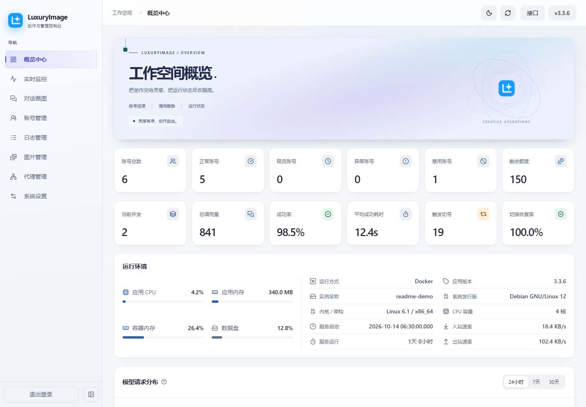
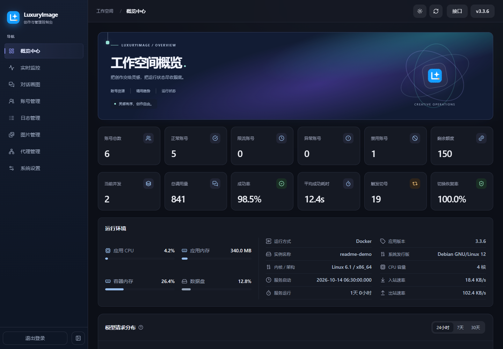
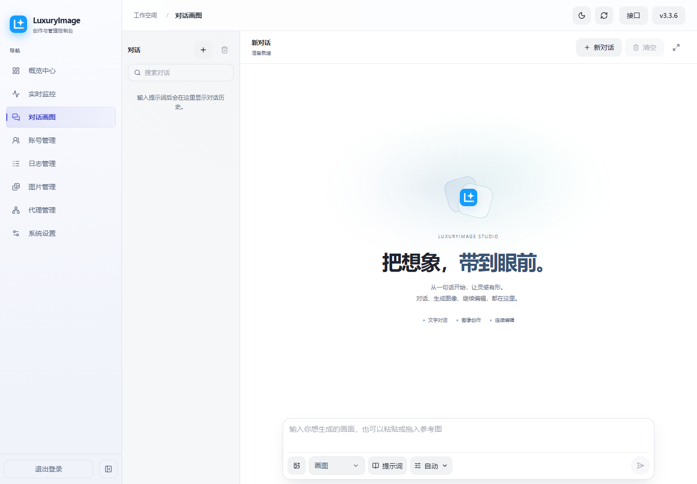
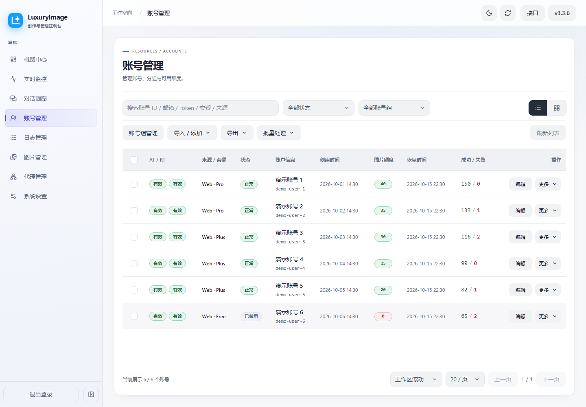
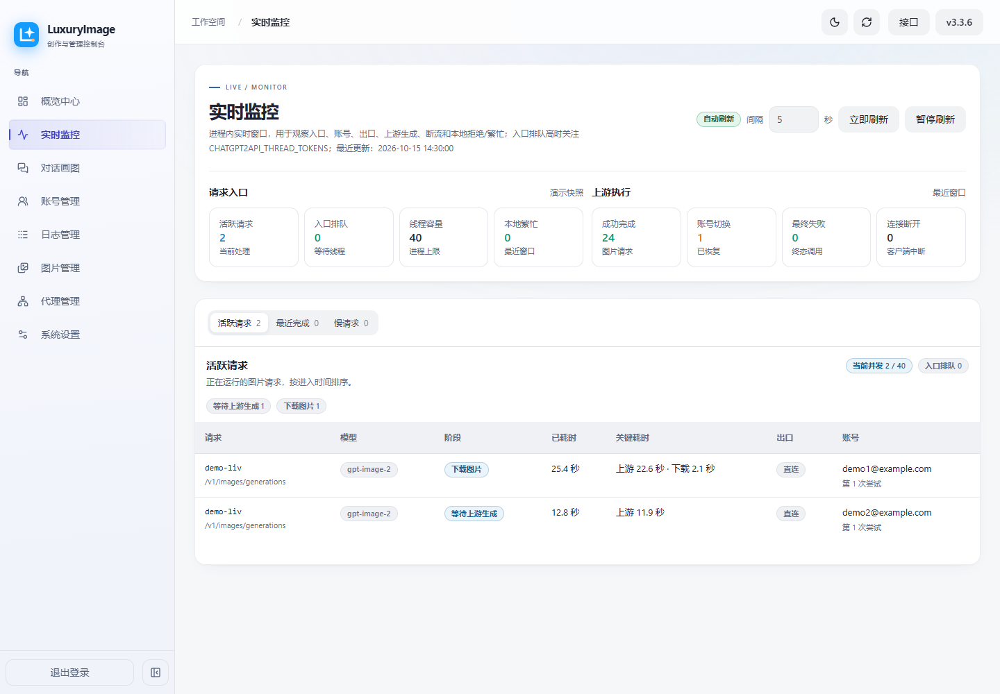
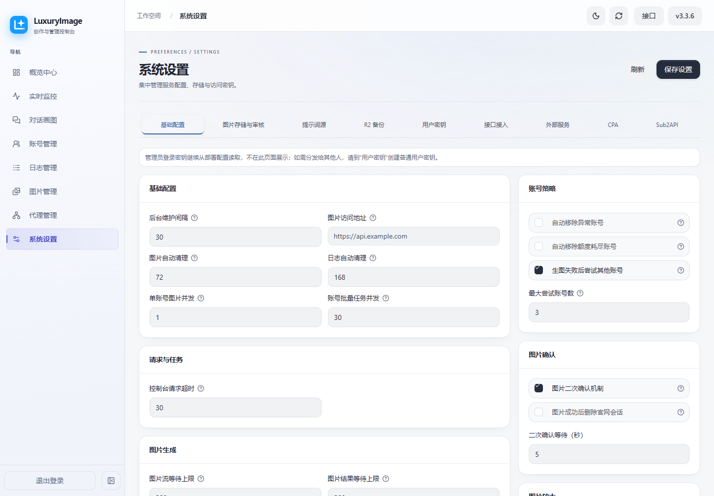

<p align="center">
  
</p>

<h1 align="center">ChatGPT2API</h1>

<p align="center">将 ChatGPT Web 的对话、搜索、图片和文件生成能力接入兼容 API，提供 LuxuryImage 管理与创作控制台。</p>

<p align="center">
  <a href="https://github.com/why-qw1ko/chatgpt2api">当前仓库</a> ·
  <a href="./CHANGELOG.md">更新说明</a> ·
  <a href="./docs/README.md">维护文档</a> ·
  <a href="./LICENSE">AGPL-3.0-only</a>
</p>

Status: current

## 项目来源

本仓库 [why-qw1ko/chatgpt2api](https://github.com/why-qw1ko/chatgpt2api) 基于 [yukkcat/chatgpt2api](https://github.com/yukkcat/chatgpt2api) 修改，后者是本仓库的直接上游。更早的代码来源为 [basketikun/chatgpt2api](https://github.com/basketikun/chatgpt2api)，对应的 MIT 版权与许可声明保留在 [NOTICE](./NOTICE)。感谢上游作者与贡献者。

以下说明以本仓库当前代码为准。控制台使用 **LuxuryImage** 品牌，技术栈为 Python 3.13+、FastAPI、Vue 3、TypeScript 和 Element Plus；Docker 构建使用 Python 3.13 与 Node.js 22。

本项目并非 OpenAI 官方服务，依赖 ChatGPT Web 上游行为及所配置账号的权限和额度；接口可用性可能随上游变化。请仅使用有权使用的账号，并遵守相关服务条款和适用法律。

## 当前功能

| 模块 | 已实现的能力 |
| --- | --- |
| 兼容 API | Chat Completions、Responses、Anthropic Messages、搜索、图片生成与编辑、PPT / PSD 异步文件任务 |
| 对话画图 | 文本对话、搜索、文生图、多参考图编辑、局部编辑、图片任务轮询、按用户密钥保存会话 |
| 账号管理 | Access Token / Refresh Token 管理、OAuth、Session JSON、CPA / 远程 CPA / Sub2API 导入、账号分组、批量操作、额度同步和账号测试 |
| 密钥与权限 | 管理员启动密钥、用户密钥、管理控制台与创作工作区能力控制 |
| 代理与调度 | 账号和账号组代理、多节点代理组、默认与备用出口、连通性检测、账号处理并发与图片并发控制 |
| 日志与监控 | 调用记录、请求详情、实时请求、图片执行阶段、失败诊断、账号切换与调用统计 |
| 图片与文件 | 图库、标签、缩略图、批量下载、压缩与清理、本地 / WebDAV 图片存储、可选图片放大与 GenBox 推送 |
| 设置与维护 | 提示词库及来源同步、SQLite / PostgreSQL、R2 备份、保留策略、亮色 / 暗色主题 |

## 部署本仓库

### 从当前源码构建 Docker 镜像

需要 Git、Docker 和 Docker Compose。以下命令使用仓库自带的 [docker-compose.local.yml](./docker-compose.local.yml)，从当前检出的代码构建镜像：

```bash
git clone https://github.com/why-qw1ko/chatgpt2api.git
cd chatgpt2api

test -f config.json || printf '{}\n' > config.json
```

启动前编辑 `config.json`，设置自己的管理员密钥。已有配置时只修改对应字段，不要覆盖整个文件：

```json
{
  "auth-key": "replace-with-your-private-key"
}
```

将示例值替换为私有密钥后启动：

```bash
docker compose -f docker-compose.local.yml up -d --build
docker compose -f docker-compose.local.yml logs -f app
```

| 入口 / 存储 | 地址 / 路径 |
| --- | --- |
| 管理与创作控制台 | `http://localhost:8000` |
| 兼容 API Base URL | `http://localhost:8000/v1` |
| 默认数据库 | 宿主机 `./data/chatgpt2api.db` |
| 持久化目录与启动配置 | 宿主机 `./data/`、`./config.json` |

使用刚设置的密钥登录，再导入上游账号。未导入可用账号时，控制台可以打开，但无法完成上游生成请求。

此 Compose 文件固定映射 `8000:80`，默认使用 SQLite。它没有将 `.env` 中的 `CHATGPT2API_AUTH_KEY` 自动传入容器，因此上述方式直接使用挂载的 `config.json`。如需改用环境变量或已有 PostgreSQL，请按文件中的注释修改 `environment`。

### 可选：同时运行 PostgreSQL 18

在仓库根目录的 `.env` 中设置 `POSTGRES_PASSWORD`；建议使用字母、数字、下划线和连字符，避免连接 URI 编码问题。然后叠加 PostgreSQL 配置：

```bash
docker compose -f docker-compose.local.yml -f docker-compose.postgres.yml up -d --build
```

数据库使用 `postgres:18-alpine`，数据保存在 `chatgpt2api-postgres-data` 命名卷，不向宿主机暴露数据库端口。以后启动、停止、查看日志和升级都应使用相同的两个 `-f` 参数。

切换 `DATABASE_URL` 不会自动迁移原数据库中的账号和业务数据。更换数据库前应备份并另行安排数据迁移。

### 镜像、安装脚本与更新来源

仓库中几条部署路径的默认来源目前不同，使用前请区分：

| 入口 | 当前代码行为 |
| --- | --- |
| `docker-compose.local.yml` | 构建当前检出的代码，服务端口为 `8000` |
| `docker-compose.yml` 与 `.env.example` | 默认镜像仍为 `ghcr.io/yukkcat/chatgpt2api:latest`，服务端口为 `3000`；基础 Compose 还包含固定的 HTTP / HTTPS 代理地址，使用前须按自己的网络环境修改 |
| `deploy/install.sh` | 默认仓库所有者为 `yukkcat`；支持 `--repo-owner why-qw1ko --repo-name chatgpt2api`，但 Docker 模式仍会下载基础 Compose，须检查其代理配置 |
| 本仓库发布工作流 | 在版本 tag 发布时配置推送到 `ghcr.io/why-qw1ko/chatgpt2api`；具体可用 tag 以实际发布结果为准 |
| 控制台版本检查与在线更新 | 查询 `why-qw1ko/chatgpt2api` 的 GitHub Releases；只有挂载独立运行目录的受管容器支持在线安装 |

直接执行默认的 `docker compose up -d` 或不带仓库参数的安装脚本，会使用上游部署默认值。若选择本仓库发布镜像，应显式设置 `CHATGPT2API_IMAGE`，并检查该 tag 已发布、基础 Compose 中的代理可用。

上面的本地构建 Compose 没有挂载受管 `/app` 运行目录，更新方式是拉取所需源码后重新构建：

```bash
git pull --ff-only
docker compose -f docker-compose.local.yml up -d --build
```

升级前备份数据库、`data/` 和启动配置。PostgreSQL 需单独导出数据库，不能只复制 `data/`；WebDAV 内容也需单独备份。不要用 `docker compose down -v` 进行普通升级，它会删除 Compose 管理的命名卷。

## API 使用

认证使用管理员密钥或控制台创建的用户密钥：

```http
Authorization: Bearer <your-key>
```

| 接口 | 方法 | 说明 |
| --- | --- | --- |
| `/v1/models` | `GET` | 与控制台共享的模型目录 |
| `/v1/chat/completions` | `POST` | 对话、搜索与图片场景 |
| `/v1/responses` | `POST` | Responses 兼容接口，支持搜索与图片工具 |
| `/v1/messages` | `POST` | Anthropic Messages 兼容接口，也接受 `x-api-key` |
| `/v1/search` | `POST` | 以 `prompt` 提交搜索，返回回答与来源 |
| `/v1/images/generations` | `POST` | 文生图，`n` 为 1–4 |
| `/v1/images/edits` | `POST` | 图片编辑，支持 multipart、URL、base64、data URL 和多参考图 |
| `/v1/editable-file-tasks` | `GET / POST` | 查询或创建 PPT / PSD 异步任务 |
| `/v1/editable-file-tasks/{task_id}` | `DELETE` | 删除当前密钥所属的终态文件任务 |
| `/v1/ppt/generations`、`/v1/psd/generations` | `POST` | 创建对应类型的异步文件任务 |
| `/images/{image_path}`、`/files/{file_path}` | `GET` | 通过生成结果中的公开链接下载图片与文件 |

文件任务按调用者身份隔离。生成结果中的图片 / 文件链接无需 Bearer Key，持有链接即可访问，请按分享需要保管链接。

聊天示例：

```bash
curl http://localhost:8000/v1/chat/completions \
  -H "Content-Type: application/json" \
  -H "Authorization: Bearer <your-key>" \
  -d '{"model":"auto","messages":[{"role":"user","content":"介绍一下这个项目"}],"stream":true}'
```

图片生成示例：

```bash
curl http://localhost:8000/v1/images/generations \
  -H "Content-Type: application/json" \
  -H "Authorization: Bearer <your-key>" \
  -d '{"model":"gpt-image-2","prompt":"一只漂浮在太空里的猫，电影感光影","n":1,"response_format":"b64_json"}'
```

内置聊天目录为 `gpt-5.6`、`auto`，默认选择 `auto`；图片默认选择 `gpt-image-2`。目录也包含 `gpt-image-2.5`、`gpt-image-2.5-flare` 和 `gpt-image-2.5-sunburst` 等 Web 兼容名称，这些名称不保证选择某个官方 API 图片引擎。显式配置和账号类型会影响目录，实际请求能力仍取决于上游账号；请以 `/v1/models` 与请求结果为准。

## 配置与数据

启动配置使用进程环境变量或 `config.json`，业务设置通过控制台维护并保存在 Application Database。

| 配置 | 默认值 / 要求 | 用途 |
| --- | --- | --- |
| `CHATGPT2API_AUTH_KEY` / `config.json` 的 `auth-key` | 必须设置 | 管理员启动密钥；非空环境变量优先 |
| `DATABASE_URL` | SQLite：`data/chatgpt2api.db` | 选择 Application Database，也支持 PostgreSQL |
| `CHATGPT2API_BASE_URL` | 未设置 | 优先于控制台的基础 URL；两者均为空时按请求地址生成图片 / 文件链接 |
| `CHATGPT2API_THREAD_TOKENS` | `120` | 后端同步工作线程容量，正整数，无固定最高值 |
| `account_processing_concurrency` | `30`，范围 1–100 | 账号导入、刷新、同步与批量处理容量 |
| `image_account_concurrency` | `1`，范围 1–3 | 单账号图片并发上限 |
| `image_stream_timeout_secs` | `80` 秒 | 图片上游流等待时间 |
| `image_poll_timeout_secs` | `60` 秒 | 图片结果轮询等待时间 |
| `log_retention_hours` | `24` 小时 | 调用日志保留时间 |

Application Database 保存账号、用户密钥、设置、代理、调用记录、统计投影、提示词库、Studio 会话和可编辑文件任务元数据。图片任务、图片索引、图库文件与生成文件另有存储；实时监控状态在进程内。详见 [存储架构](./docs/storage-architecture.md)，具体默认值和约束见 [设置规范](./contracts/settings_specification.py)。

不要提交 `.env`、`config.json`、`data/` 或真实账号凭证。

## 当前界面

以下为当前代码在隔离演示环境中重新拍摄的真实浏览器截图。截图中的演示数据不含真实账号凭证，也不代表线上运行量或性能。

<table width="100%">
  <tr><th width="50%">概览 · 亮色</th><th width="50%">概览 · 暗色</th></tr>
  <tr><td></td><td></td></tr>
  <tr><th>对话画图</th><th>账号管理</th></tr>
  <tr><td></td><td></td></tr>
  <tr><th>实时监控</th><th>系统设置</th></tr>
  <tr><td></td><td></td></tr>
</table>

## 本地开发

需要 Python 3.13+、uv 和 Node.js 22 / npm。先按部署章节创建 `config.json` 并设置密钥，也可以在启动后端的终端设置 `CHATGPT2API_AUTH_KEY`；直接运行 Python 不会自动加载根目录 `.env`。

在仓库根目录启动后端：

```bash
uv sync --frozen
uv run main.py
```

后端默认监听 `http://127.0.0.1:8000`。另开终端启动前端：

```bash
cd web-vue
npm ci
npm run dev
```

前端默认地址为 `http://localhost:5173`，Vite 将管理和兼容 API 请求代理到 `http://localhost:8000`；可通过 `VITE_DEV_API_TARGET` 修改代理目标。生产前端构建使用 `npm run build`，输出到 `web-vue/dist/`；后端托管静态资源的目录为根目录 `web_dist/`，Docker 构建会自动复制产物。

## 维护文档

- [版本维护与发布](./docs/runbooks/release.md)：版本号、更新说明、标签发布及部署升级方式。
- [文档索引](./docs/README.md)：专题文档与维护入口。
- [系统地图](./docs/maps/system-map.md)：系统边界及模块关系。
- [控制台架构](./docs/control-panel-architecture.md)：后端投影与前端交互职责。
- [图片失败处理](./docs/image-failure-handling.md)：失败分类、重试和账号处置。
- [上游 SSE](./docs/upstream-sse-conversation.md)：会话与流式解析。

文档与实现冲突时，以当前代码和公开接口契约为准。

## 许可证

本仓库当前代码按 [GNU Affero General Public License v3.0](./LICENSE)（`AGPL-3.0-only`）发布。修改后通过网络提供服务时，须按许可证向服务用户提供对应源码。

源自 [basketikun/chatgpt2api](https://github.com/basketikun/chatgpt2api) 的代码继续保留原 MIT 版权与许可声明，详见 [NOTICE](./NOTICE)。直接上游为 [yukkcat/chatgpt2api](https://github.com/yukkcat/chatgpt2api)，本仓库修改与发布记录见 [CHANGELOG](./CHANGELOG.md) 和 [GitHub](https://github.com/why-qw1ko/chatgpt2api)。
